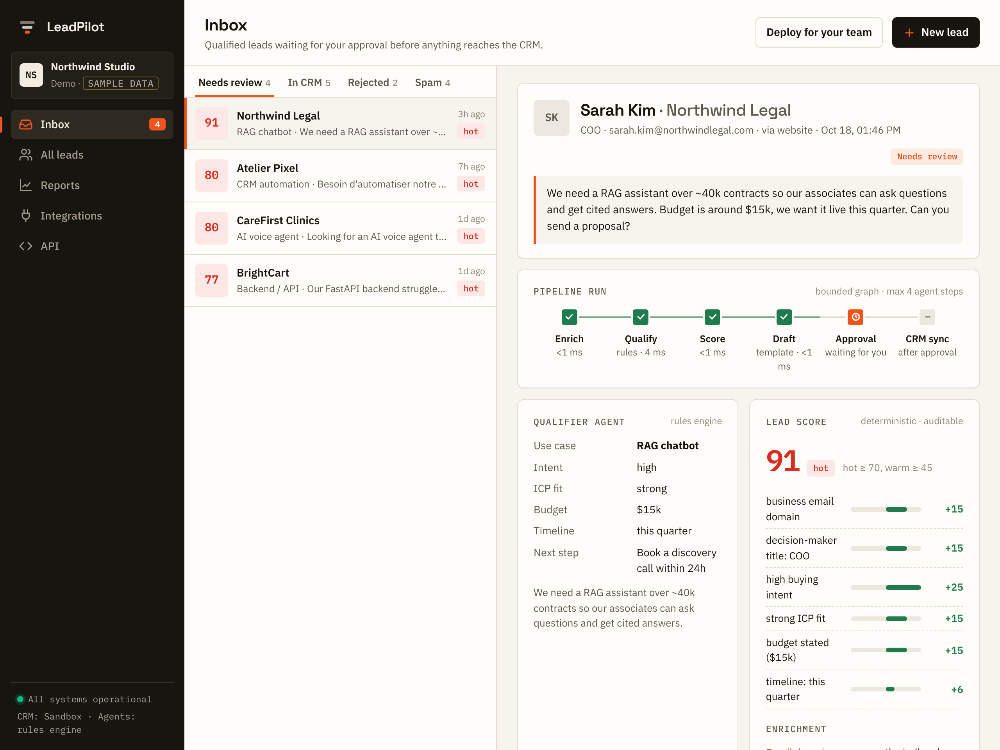
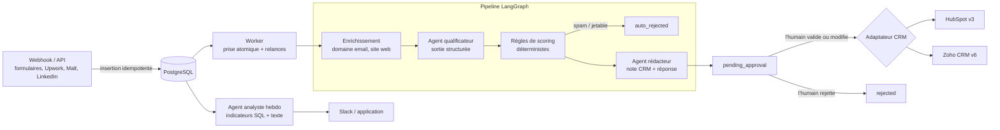
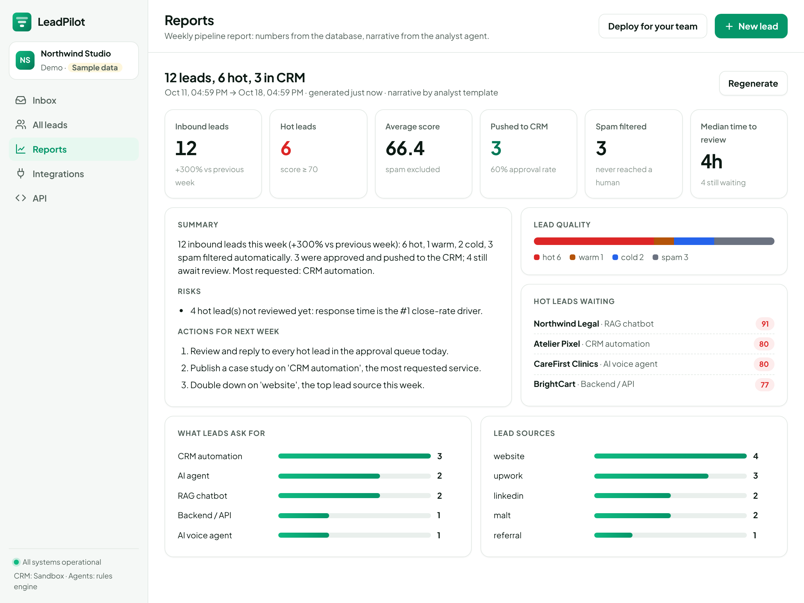
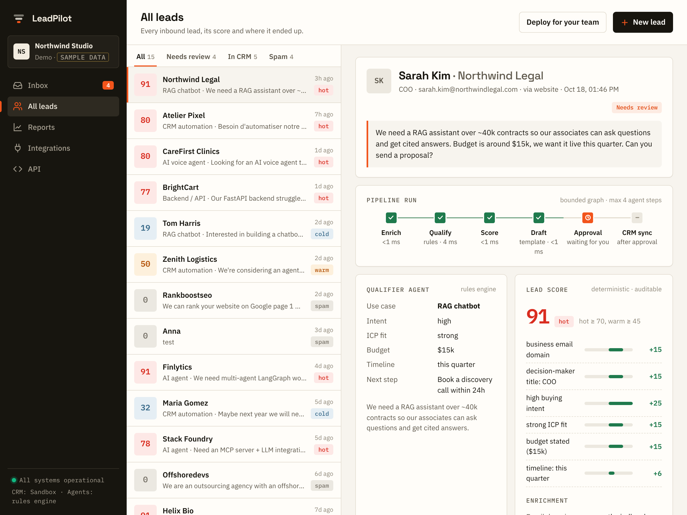
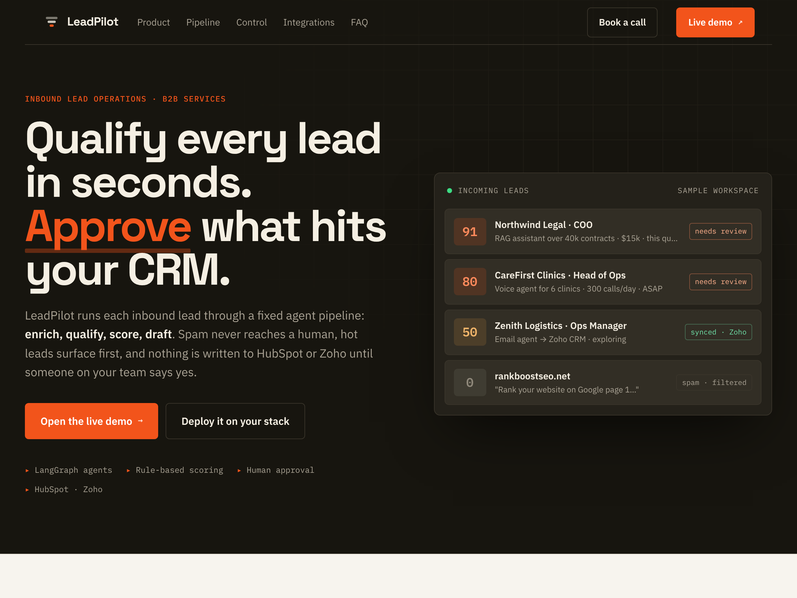
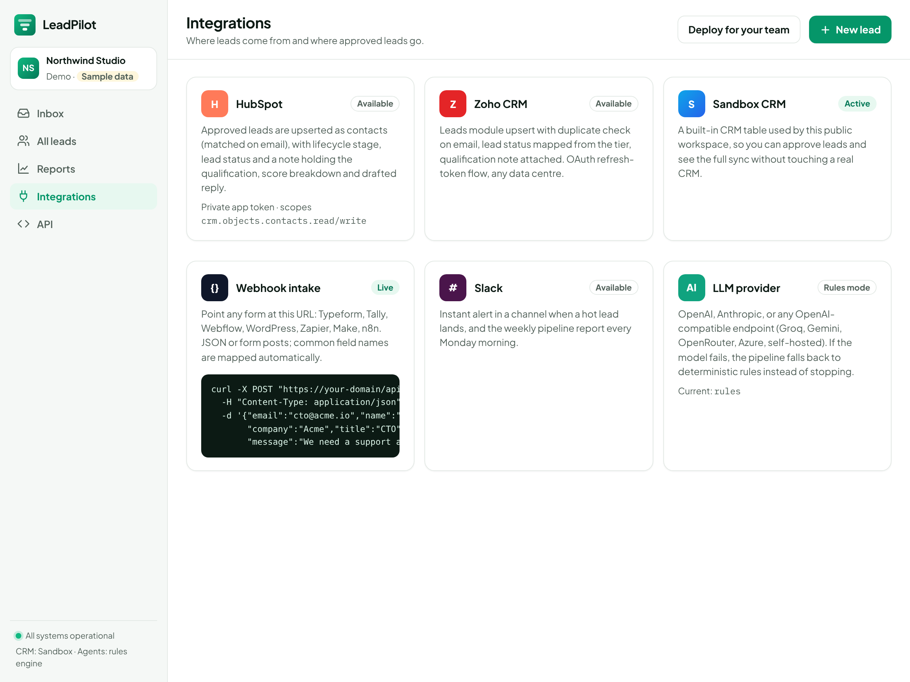

<p align="center"></p>

<h1 align="center">LeadPilot</h1>

<p align="center">
  <b>Qualifiez chaque prospect entrant en quelques secondes. Validez ce qui entre dans votre CRM.</b><br>
  <a href="README.md">Read in English</a> ·
  <a href="https://leadpilot-rust-iota.vercel.app">Démo en ligne</a> ·
  <a href="#lancer-le-projet-en-local">Lancer en local</a>
</p>

<p align="center">
  
  
  
  
  
  
</p>



---

## Sommaire

1. [Présentation](#présentation)
2. [Choix de conception](#choix-de-conception)
3. [Comment un prospect est traité](#comment-un-prospect-est-traité)
4. [Fonctionnalités](#fonctionnalités)
5. [Règles de scoring](#règles-de-scoring)
6. [Captures d'écran](#captures-décran)
7. [Stack technique](#stack-technique)
8. [Structure du projet](#structure-du-projet)
9. [Lancer le projet en local](#lancer-le-projet-en-local)
10. [Configuration](#configuration)
11. [Endpoints de l'API](#endpoints-de-lapi)
12. [Connecter un vrai CRM](#connecter-un-vrai-crm)
13. [Déploiement](#déploiement)
14. [Tests](#tests)

---

## Présentation

Les équipes de services B2B reçoivent des prospects de partout : formulaires du site, Upwork, Malt, LinkedIn, automatisations Zapier ou n8n. Il faut lire chaque demande, décider si elle mérite une réponse, la recopier dans le CRM et écrire une première réponse. Les prospects chauds attendent, le spam passe, et le CRM se remplit de fiches incomplètes.

**LeadPilot** est un système multi-agents qui fait ce tri à votre place :

1. il **enrichit** chaque prospect (type de domaine de l'email, site de l'entreprise),
2. un agent IA le **qualifie** par rapport à votre client idéal (intention d'achat, adéquation, budget, délai, cas d'usage),
3. une grille de règles déterministe lui donne un **score** de 0 à 100, avec le détail de chaque point,
4. le **spam** et les emails jetables sont rejetés automatiquement,
5. un deuxième agent **rédige** la note CRM et un premier email de réponse,
6. un humain **valide** (et peut modifier) le brouillon avant que quoi que ce soit soit écrit dans **HubSpot** ou **Zoho**,
7. chaque semaine, un agent analyste rédige un **rapport de pipeline** autour de chiffres calculés en SQL.

L'application fonctionne entièrement **sans aucune clé d'API** : avec `LLM_PROVIDER=none` et `CRM_PROVIDER=mock`, des heuristiques déterministes remplacent les agents et un CRM simulé enregistre les contacts. La démo publique tourne ainsi, sur un espace d'exemple (**Northwind Studio**) remis à zéro chaque jour.

## Choix de conception

| Problème réel des équipes commerciales | Ce que fait LeadPilot |
| --- | --- |
| Les prospects chauds attendent des jours parce que personne ne trie la boîte | Chaque prospect est traité en quelques secondes ; les prospects chauds sont signalés sur Slack |
| Les scores donnés par un LLM varient et personne ne peut les expliquer | Le LLM se contente d'**extraire des signaux** ; le score vient d'une grille de règles déterministe, détaillée point par point |
| Une IA qui écrit directement dans le CRM le pollue | **Humain dans la boucle** : rien n'arrive dans le CRM tant que quelqu'un n'a pas validé, et éventuellement modifié, le brouillon |
| Des agents qui tournent en boucle et consomment des tokens | Un **graphe LangGraph borné** : au maximum 4 étapes par prospect, un coût prévisible |
| Une panne du fournisseur bloque tout | Chaque agent a une solution de repli déterministe ; un traitement en échec est relancé jusqu'à 3 fois, avec un historique |
| Des rapports avec des chiffres inventés | Les indicateurs sont calculés en SQL ; l'agent analyste rédige seulement le texte autour |
| Dépendance à un seul CRM | Un protocole `CRMAdapter` : HubSpot et Zoho inclus, un nouveau CRM tient dans un seul fichier |

## Comment un prospect est traité



**Statuts d'un prospect :** `received` → `processing` → `pending_approval` → `synced` (ou `rejected` par un humain). Le spam part directement en `auto_rejected`. Un prospect dont le pipeline échoue 3 fois passe en `failed` et peut être relancé.

**Où tourne le pipeline :**
- sur un hébergement permanent (Docker, Render), l'API répond tout de suite et un worker en arrière-plan traite la file ; un planificateur génère le rapport hebdomadaire ;
- sur Vercel (serverless), le pipeline borné s'exécute pendant la requête (quelques secondes par prospect), et un cron quotidien traite ce qui reste dans la file et génère le rapport.

## Fonctionnalités

**Réception des prospects**
- `POST /api/leads` avec un en-tête `Idempotency-Key` optionnel : un même prospect envoyé deux fois n'est enregistré qu'une fois.
- `POST /api/webhooks/lead?source=...` : accepte du JSON ou des formulaires venant de Typeform, Webflow, Tally, WordPress, Zapier, n8n, et reconnaît automatiquement les noms de champs courants. Protégé par un secret partagé.

**Enrichissement**
- Classe le domaine de l'email : professionnel, messagerie gratuite (Gmail, Outlook...) ou jetable.
- Lit le titre et la description du site de l'entreprise.
- **Protection SSRF :** les adresses privées, locales, link-local et réservées sont refusées, et chaque redirection est vérifiée une par une.

**Agent qualificateur** (sortie structurée Pydantic)
- Détection du spam, intention d'achat, adéquation au client idéal, signal et montant du budget, délai, cas d'usage, résumé du besoin, prochaine action recommandée, et une justification qui cite les mots du prospect.

**Agent rédacteur**
- Une note CRM pour l'équipe commerciale et un premier email de réponse adapté au prospect, signé au nom de votre équipe. La réponse reste un brouillon : LeadPilot l'enregistre avec la note CRM, il n'envoie pas d'emails.

**Validation humaine**
- Boîte de réception avec file de validation, déroulé du pipeline pour chaque prospect avec la durée de chaque étape, détail du score, brouillon modifiable (note, étape, réponse), boutons valider / rejeter / relancer, et historique complet.

**Synchronisation CRM**
- **HubSpot :** recherche le contact par email, le crée ou le met à jour (l'étape du cycle de vie est fixée à la création, car HubSpot refuse de la faire reculer), et ajoute une note associée.
- **Zoho CRM :** renouvellement du jeton OAuth, création ou mise à jour sur l'email, ajout d'une note.
- Relances sur les erreurs HTTP 429 et 5xx avec un délai croissant, en respectant `Retry-After`. Si l'écriture dans le CRM échoue, le prospect reste dans la file de validation.

**Rapport hebdomadaire**
- Volume de prospects et évolution par rapport à la période précédente, répartition par statut, niveau et source, principaux cas d'usage, score moyen, spam filtré, taux de validation, délai médian de traitement, prospects chauds encore en attente, et 3 actions pour la semaine suivante. Envoyé sur Slack si un webhook est configuré.

**Application web et site produit**
- `/app` : boîte de réception, liste des prospects, rapports, intégrations et page API. Thèmes clair et sombre, affichage mobile. JavaScript natif, aucune étape de build.
- `/` : page d'accueil du produit avec un lien vers la démo.

**Sécurité**
- Clé d'API sur les espaces privés (`X-API-Key`), secret partagé pour le webhook, secret pour le cron, protection SSRF, limite de soumissions par IP sur la démo publique.

## Règles de scoring

Le score est la somme de ces règles, ramenée entre 0 et 100 ([`app/scoring.py`](app/scoring.py)). Chaque règle appliquée apparaît dans le détail du score du prospect, avec sa raison.

| Règle | Points |
| --- | --- |
| Domaine de l'email | professionnel +15 · gratuit 0 · jetable −30 |
| Site de l'entreprise accessible | +5 |
| Poste | décideur (fondateur, CEO, CTO, VP, directeur...) +15 · intermédiaire (manager, lead, responsable, PM...) +8 |
| Intention d'achat | forte +25 · moyenne +12 · faible 0 |
| Adéquation au client idéal | forte +15 · partielle +7 · aucune −10 |
| Budget | annoncé +15 · sous-entendu +8 · aucun 0 |
| Délai | immédiat +10 · ce trimestre +6 · plus tard ou inconnu 0 |
| Message de moins de 20 caractères | −10 |

Niveaux : **chaud** à partir de 70, **tiède** à partir de 45, **froid** en dessous (seuils réglables avec `HOT_THRESHOLD` et `WARM_THRESHOLD`). Le niveau fixe l'étape CRM proposée : chaud → SQL, tiède → MQL, froid → lead.

## Captures d'écran

| Rapport hebdomadaire | Tous les prospects |
| --- | --- |
|  |  |

| Page d'accueil | Intégrations |
| --- | --- |
|  |  |

L'interface de l'application est en anglais.

## Stack technique

| Couche | Technologie |
| --- | --- |
| Agents | LangGraph, LangChain (OpenAI, Anthropic, ou tout endpoint compatible OpenAI comme Groq, Gemini, OpenRouter) |
| Backend | Python 3.12, FastAPI, Pydantic v2, APScheduler, httpx |
| Données | SQLAlchemy 2, PostgreSQL (SQLite en développement et pour les tests) |
| Intégrations | API HubSpot CRM v3, API Zoho CRM v6, webhooks entrants Slack |
| Front | HTML, CSS, JavaScript natif (aucune étape de build) |
| Qualité | pytest, GitHub Actions (tests SQLite et PostgreSQL, build Docker) |
| Déploiement | Docker, Docker Compose, blueprint Render, Vercel + Neon |

## Structure du projet

```
app/
  main.py         Application FastAPI, endpoints, worker, planificateur, cron
  graph.py        Pipeline LangGraph : enrichir → qualifier → scorer → rédiger
  agents.py       Agents qualificateur et rédacteur, et leurs replis déterministes
  scoring.py      Grille de règles déterministe et niveaux
  enrichment.py   Enrichissement domaine email et site web, protection SSRF
  services.py     Prise et traitement des tâches, validation, rejet, alerte Slack
  report.py       Indicateurs hebdomadaires et agent analyste
  llm.py          Choix du fournisseur de modèle
  crm/            Protocole CRMAdapter, HubSpot, Zoho, CRM simulé
  demo.py         Espace d'exemple pour la démo publique
  models.py       Tables des prospects, événements et rapports
  schemas.py      Schémas de l'API et des sorties des agents
  static/         Site produit et application web
docs/             Guide de déploiement en français, notes portfolio, captures
scripts/          Envoie des prospects d'exemple à une instance en ligne
tests/            Tests du pipeline, de l'API, des CRM et de la plateforme
```

## Lancer le projet en local

**Avec Docker** (API + PostgreSQL) :

```bash
git clone https://github.com/Dioumadev221/leadpilot.git
cd leadpilot
cp .env.example .env            # ajoutez OPENAI_API_KEY, ou mettez LLM_PROVIDER=none
docker compose up --build
# ouvrez http://localhost:8000/app (l'application demande API_KEY une fois)
```

**Sans Docker** (SQLite, aucune clé nécessaire) :

```bash
python -m venv .venv && source .venv/bin/activate
pip install -r requirements-dev.txt
SEED_DEMO=true LLM_PROVIDER=none uvicorn app.main:app --reload
```

**Envoyer un prospect :**

```bash
curl -X POST "localhost:8000/api/webhooks/lead?source=website" \
  -H "X-Webhook-Secret: $WEBHOOK_SECRET" -H "Content-Type: application/json" \
  -d '{"email":"cto@acme.io","name":"Alex Martin","company":"Acme","title":"CTO",
       "message":"We need a RAG assistant over our docs. Budget $12k, live next month."}'
```

Documentation interactive de l'API : `http://localhost:8000/docs`.

## Configuration

Tous les réglages sont des variables d'environnement (voir [`.env.example`](.env.example)).

| Variable | Rôle |
| --- | --- |
| `DATABASE_URL` | Chaîne de connexion PostgreSQL (SQLite par défaut) |
| `API_KEY` | Envoyée en `X-API-Key` par l'application et les clients de l'API. Vide = pas d'authentification (local ou démo publique uniquement) |
| `WEBHOOK_SECRET` | En-tête `X-Webhook-Secret` ou paramètre `?secret=` du webhook |
| `WORKSPACE_NAME`, `SENDER_NAME` | Nom de votre entreprise et signature des réponses rédigées |
| `ICP_DESCRIPTION` | Description de votre client idéal, utilisée par l'agent qualificateur |
| `LLM_PROVIDER` | `openai`, `anthropic` ou `none` (heuristiques déterministes, sans clé) |
| `LLM_MODEL`, `OPENAI_API_KEY`, `OPENAI_BASE_URL`, `ANTHROPIC_API_KEY` | Réglages du modèle. `OPENAI_BASE_URL` accepte tout endpoint compatible OpenAI |
| `CRM_PROVIDER` | `mock`, `hubspot` ou `zoho` |
| `HUBSPOT_TOKEN` | Jeton d'application privée HubSpot |
| `ZOHO_CLIENT_ID`, `ZOHO_CLIENT_SECRET`, `ZOHO_REFRESH_TOKEN`, `ZOHO_DC` | OAuth Zoho et centre de données (`com`, `eu`, `in`...) |
| `HOT_THRESHOLD`, `WARM_THRESHOLD` | Seuils des niveaux (70 et 45 par défaut) |
| `SLACK_WEBHOOK_URL` | Alertes prospects chauds et rapport hebdomadaire |
| `RUN_WORKER`, `REPORT_CRON_DAY`, `REPORT_CRON_HOUR` | Worker en arrière-plan et planning du rapport (hébergement permanent) |
| `ENRICH_FETCH_WEBSITE` | Active ou désactive la lecture du site web |
| `DEMO_MODE`, `DEMO_SUBMISSIONS_PER_HOUR`, `SEED_DEMO`, `CRON_SECRET`, `PUBLIC_URL`, `CONTACT_URL` | Démo publique, données d'exemple, protection du cron, aperçus de lien |

## Endpoints de l'API

| Méthode | Chemin | Description |
| --- | --- | --- |
| `POST` | `/api/leads` | Créer un prospect (`Idempotency-Key` pris en charge) |
| `POST` | `/api/webhooks/lead` | Recevoir un prospect depuis un formulaire ou un outil d'automatisation |
| `GET` | `/api/leads` | Lister les prospects |
| `GET` | `/api/leads/{id}` | Détail d'un prospect : enrichissement, qualification, score, brouillon, historique |
| `POST` | `/api/leads/{id}/approve` | Valider (avec modifications éventuelles) et écrire dans le CRM |
| `POST` | `/api/leads/{id}/reject` | Rejeter avec un motif |
| `POST` | `/api/leads/{id}/reprocess` | Relancer le pipeline |
| `GET` | `/api/stats` | Compteurs pour l'application |
| `GET` | `/api/reports`, `/api/reports/latest` | Rapports hebdomadaires |
| `POST` | `/api/reports/generate` | Générer un rapport maintenant |
| `GET` | `/api/meta` | Espace de travail, mode LLM et CRM pour l'application |
| `GET` | `/api/cron/daily` | Cron quotidien : vider la file, rapport, remise à zéro de la démo |
| `GET` | `/health` | Vérification de l'état du service |

## Connecter un vrai CRM

**HubSpot (l'offre gratuite suffit) :** Settings → Integrations → Private Apps → créez une application avec les scopes `crm.objects.contacts.read` et `crm.objects.contacts.write` → copiez le jeton → mettez `CRM_PROVIDER=hubspot` et `HUBSPOT_TOKEN=pat-...`.

**Zoho CRM :** api-console.zoho.com → Self Client → scopes `ZohoCRM.modules.leads.ALL,ZohoCRM.modules.notes.CREATE` → générez un code → échangez-le une fois contre un refresh token :

```bash
curl -X POST "https://accounts.zoho.com/oauth/v2/token?grant_type=authorization_code&client_id=ID&client_secret=SECRET&code=CODE"
```

Puis renseignez `CRM_PROVIDER=zoho`, `ZOHO_CLIENT_ID`, `ZOHO_CLIENT_SECRET`, `ZOHO_REFRESH_TOKEN` et `ZOHO_DC`.

## Déploiement

### Vercel + Neon (serverless, offre gratuite)

[](https://vercel.com/new/clone?repository-url=https%3A%2F%2Fgithub.com%2FDioumadev221%2Fleadpilot)

1. Créez une base Postgres sur [Neon](https://neon.tech) et copiez la chaîne de connexion **pooled**.
2. Importez le dépôt dans Vercel. [`vercel.json`](vercel.json) règle la durée maximale des fonctions et un cron quotidien sur `/api/cron/daily`.
3. Renseignez les variables d'environnement : `DATABASE_URL`, `CRON_SECRET`, `API_KEY`, `WEBHOOK_SECRET`, et vos clés de modèle et de CRM. Pour une démo publique, mettez `DEMO_MODE=true` et laissez `API_KEY` vide.
4. Déployez, puis mettez le domaine final dans `PUBLIC_URL` pour que les aperçus de lien affichent l'image du produit.

Un guide pas à pas est disponible dans [`docs/DEPLOY_FR.md`](docs/DEPLOY_FR.md).

### Docker / Render

`docker compose up`, ou Render → New → **Blueprint** : [`render.yaml`](render.yaml) crée le service web et la base PostgreSQL. Sur un hébergement permanent, le worker et le planificateur hebdomadaire sont actifs, une seule instance suffit.

## Tests

```bash
pip install -r requirements-dev.txt
pytest -q
```

Les tests couvrent le routage du pipeline (chaud, froid, spam, email jetable), le scoring déterministe, le repli quand le modèle échoue, le parcours complet de l'API jusqu'au CRM, l'idempotence, la reconnaissance des champs du webhook, les relances jusqu'au statut `failed`, les indicateurs du rapport, l'authentification, le secret du cron et la remise à zéro de la démo, la limite de la démo, le traitement en mode serverless, la protection SSRF, et le format des requêtes HubSpot et Zoho sur des réponses HTTP simulées.

GitHub Actions lance les tests sur SQLite et sur PostgreSQL, puis construit l'image Docker, à chaque push et pull request.
