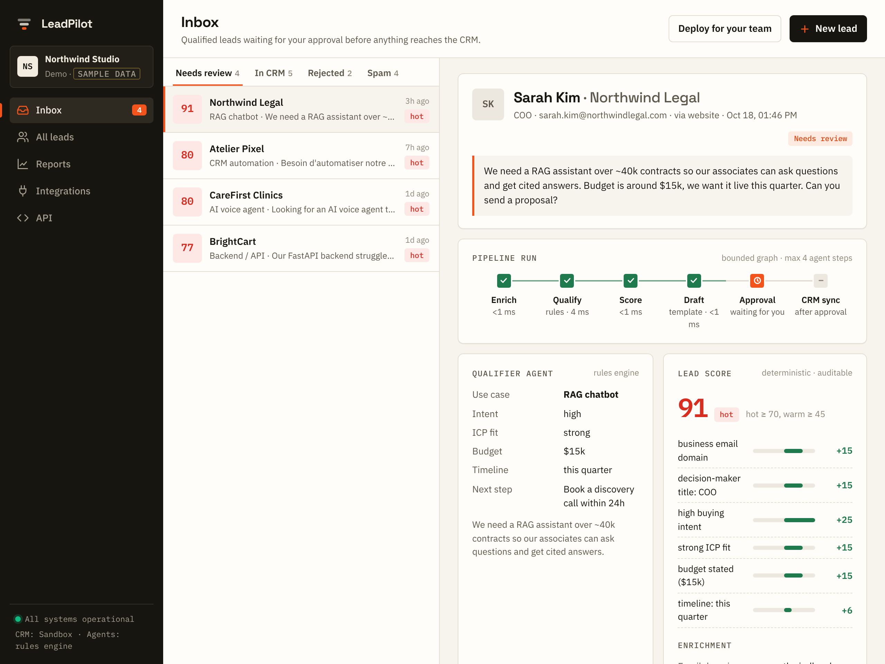
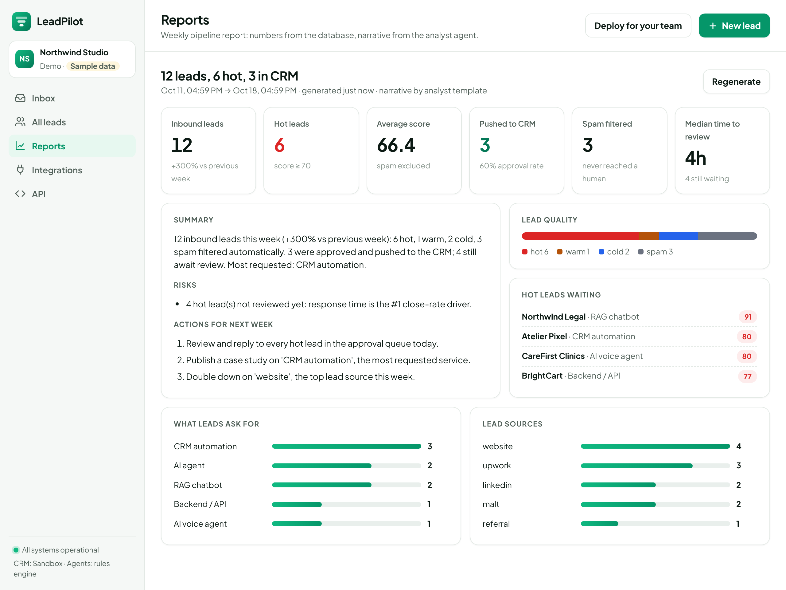
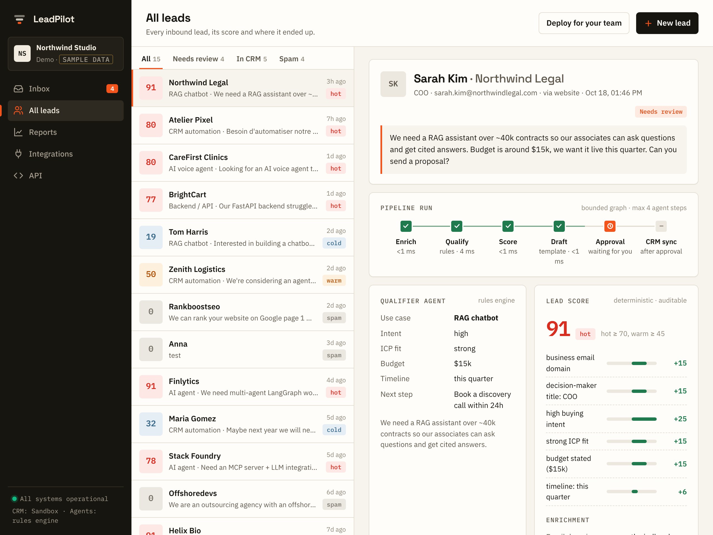
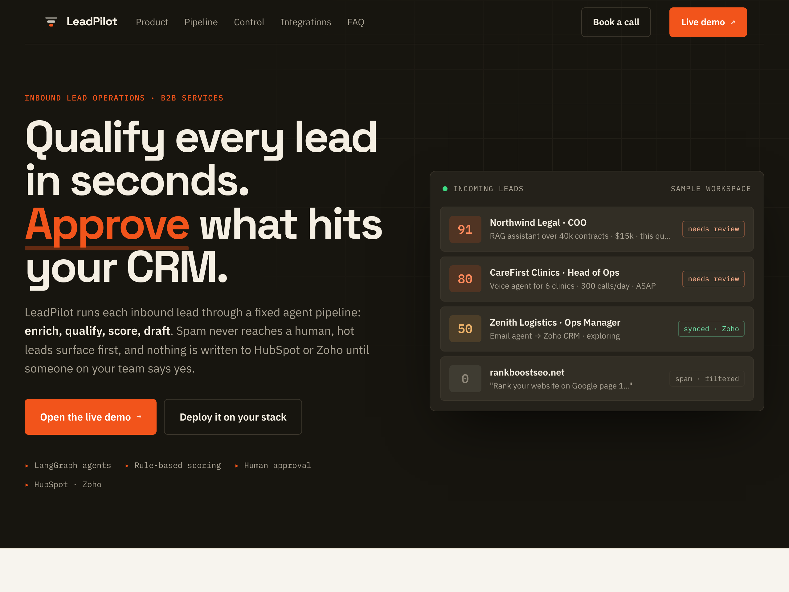
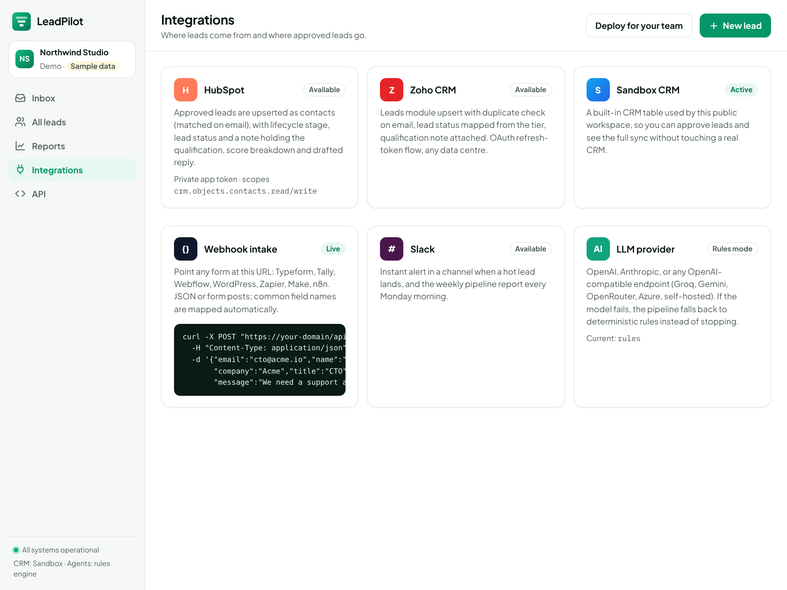
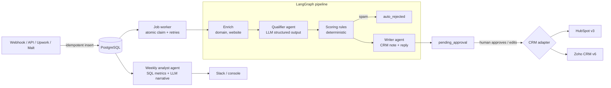

<p align="center"></p>

# LeadPilot

**Qualify every lead in seconds. Approve what hits your CRM.**

**Live demo:** https://leadpilot-rust-iota.vercel.app · sample workspace, resets daily

LeadPilot is a multi-agent system for B2B service teams. Leads arrive from forms, Upwork, Malt, LinkedIn or any webhook. LeadPilot **enriches** each one, has an AI agent **qualify** it against your ideal customer profile, **scores** it with an auditable rule table, **filters spam** and drafts the **CRM note and first reply**. Nothing is written to **HubSpot or Zoho** until a human approves it. Every week an analyst agent writes the **pipeline report**.



| | |
|---|---|
|  |  |
|  |  |

## Why it is built this way

| Problem in real sales teams | What LeadPilot does |
|---|---|
| Hot leads wait days because nobody triages the inbox | Every lead is qualified in seconds; hot ones ping Slack |
| LLM scores drift and nobody can explain them | The LLM only **extracts signals**; the score is a deterministic rule table with a per-point breakdown |
| An AI writing straight into the CRM pollutes it | **Human-in-the-loop**: nothing reaches the CRM until someone approves (and can edit) the draft |
| Agents that loop and burn tokens | A **bounded LangGraph DAG**: max 4 steps per lead, predictable cost |
| Provider outage = pipeline down | Each agent has a deterministic fallback; failures retry 3x with an audit trail |
| Reports with invented numbers | Metrics come from SQL; the analyst agent only writes the narrative around them |
| Locked into one CRM | `CRMAdapter` protocol: HubSpot and Zoho included, new CRM = one file |

## Architecture



**Stack:** Python 3.12, FastAPI, LangGraph, LangChain (OpenAI, Anthropic or any OpenAI-compatible model), SQLAlchemy 2 + PostgreSQL, APScheduler, httpx, Docker, GitHub Actions. Runs serverless on Vercel or as a container.

## Features

- **Intake:** `POST /api/leads` (with `Idempotency-Key`) and `POST /api/webhooks/lead` that maps fields from Typeform, Webflow, Tally, WordPress, Zapier, n8n (JSON or form posts, shared secret).
- **Enrichment:** business vs free vs disposable email, company website title/description.
- **Qualifier agent:** intent, ICP fit, budget, timeline, use case, next step, reasoning quoting the lead (Pydantic structured output).
- **Scoring:** 9 rules, 0–100, hot / warm / cold, thresholds via env.
- **Writer agent:** CRM note + first reply email tailored to the lead.
- **Web app** (`/app`): inbox with approval queue, pipeline run per lead with timings, score breakdown, editable draft, approve/reject, audit trail, reports, integrations and API pages. Light and dark themes, mobile layout.
- **Product site** (`/`): landing page with live demo link.
- **Security:** API key on private workspaces, webhook shared secret, SSRF guard on website enrichment (private and internal addresses refused, redirects checked hop by hop), per-IP limit on the public demo.
- **CRM sync:** HubSpot (search → create/patch contact, note associated to contact, lifecycle stage), Zoho (OAuth refresh, upsert on Email, note). Retries on 429/5xx with `Retry-After`.
- **Jobs:** DB-backed queue with atomic `received → processing` claim, 3 attempts then `failed`; weekly report on cron.
- **Report:** volume and week-over-week change, tiers, sources, top use cases, approval rate, median review time, hot leads waiting, 3 actions.
- **Runs without any key:** `LLM_PROVIDER=none` and `CRM_PROVIDER=mock` give a full working demo.

## Run it locally

```bash
cp .env.example .env            # put your OPENAI_API_KEY, or set LLM_PROVIDER=none
docker compose up --build       # API + PostgreSQL
open http://localhost:8000/app  # the app asks for API_KEY once
```

Without Docker:

```bash
python -m venv .venv && source .venv/bin/activate
pip install -r requirements-dev.txt
SEED_DEMO=true LLM_PROVIDER=none uvicorn app.main:app --reload
pytest -q
```

Send a lead:

```bash
curl -X POST localhost:8000/api/webhooks/lead?source=website \
  -H "X-Webhook-Secret: $WEBHOOK_SECRET" -H "Content-Type: application/json" \
  -d '{"email":"cto@acme.io","name":"Alex Martin","company":"Acme","title":"CTO",
       "message":"We need a RAG assistant over our docs. Budget $12k, live next month."}'
```

API docs: `http://localhost:8000/docs`.

## Connect a real CRM

**HubSpot (free):** Settings → Integrations → Private Apps → create app with scopes `crm.objects.contacts.read` and `crm.objects.contacts.write` → copy the token → `CRM_PROVIDER=hubspot`, `HUBSPOT_TOKEN=pat-...`.

**Zoho CRM:** api-console.zoho.com → Self Client → scopes `ZohoCRM.modules.leads.ALL,ZohoCRM.modules.notes.CREATE` → generate code → exchange it once for a refresh token:

```bash
curl -X POST "https://accounts.zoho.com/oauth/v2/token?grant_type=authorization_code&client_id=ID&client_secret=SECRET&code=CODE"
```

Then `CRM_PROVIDER=zoho`, `ZOHO_CLIENT_ID`, `ZOHO_CLIENT_SECRET`, `ZOHO_REFRESH_TOKEN`, `ZOHO_DC` (`com`, `eu`, `in`...).

## Deploy

### Vercel + Neon (serverless, free tier)

[](https://vercel.com/new/clone?repository-url=https%3A%2F%2Fgithub.com%2FDioumadev221%2Fleadpilot)

1. Create a Postgres database on [Neon](https://neon.tech) and copy the **pooled** connection string.
2. Import the repo in Vercel. `vercel.json` sets the function timeout and a daily cron on `/api/cron/daily`.
3. Environment variables: `DATABASE_URL`, `CRON_SECRET` (random string), `API_KEY`, `WEBHOOK_SECRET`, and your LLM and CRM keys. For a public demo set `DEMO_MODE=true` and leave `API_KEY` empty.
4. Deploy. Set `PUBLIC_URL` to the final domain so link previews show the product image.

On Vercel the pipeline runs inside the request (a few seconds per lead, bounded graph), and the daily cron drains anything left in the queue and writes the report. In demo mode the cron also resets the sample workspace.

### Docker / Render

`docker compose up` or Render → New → **Blueprint** (`render.yaml` creates the web service and Postgres). On a long-running host the in-process worker and the weekly scheduler are on, so a single instance is enough.

## Tests

32 tests: pipeline routing (hot / cold / spam / disposable), deterministic scoring, LLM failure fallback, full API flow to CRM, idempotency, webhook field mapping, retries → failed, report metrics, auth, cron secret and demo reset, demo rate limit, serverless inline processing, SSRF guard, and HubSpot/Zoho request shapes against mocked HTTP. CI runs them on SQLite **and** PostgreSQL, then builds the image.

## Project layout

```
app/
  main.py         FastAPI app, worker thread, scheduler, cron, endpoints
  graph.py        LangGraph pipeline
  agents.py       qualifier + writer agents and their fallbacks
  scoring.py      deterministic rule table
  enrichment.py   domain + website enrichment
  services.py     job claim/processing, approval, rejection
  report.py       weekly metrics + analyst agent
  crm/            CRMAdapter protocol, HubSpot, Zoho, mock
  demo.py         sample workspace for the public demo
  static/         product site + web app (vanilla JS, no build step)
tests/
```
