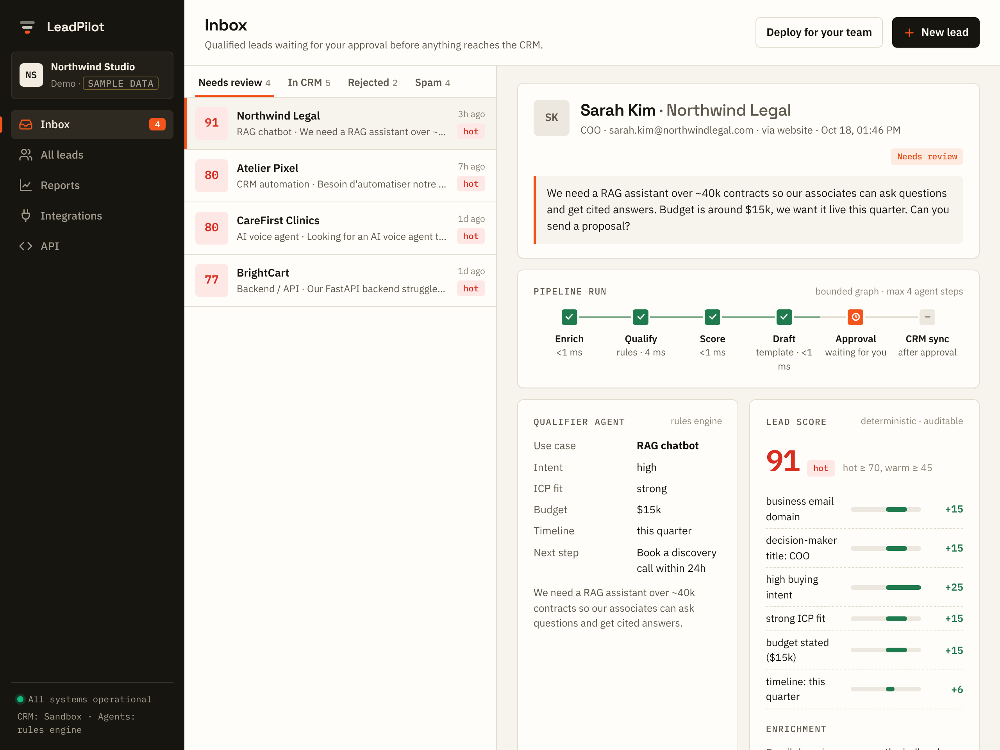
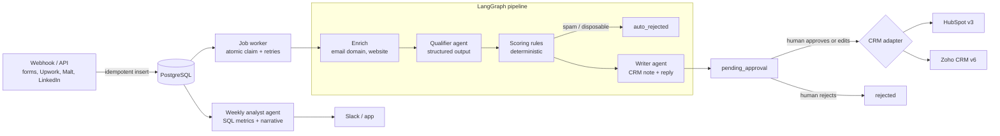
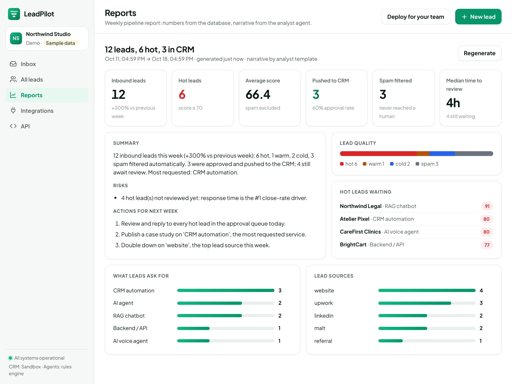
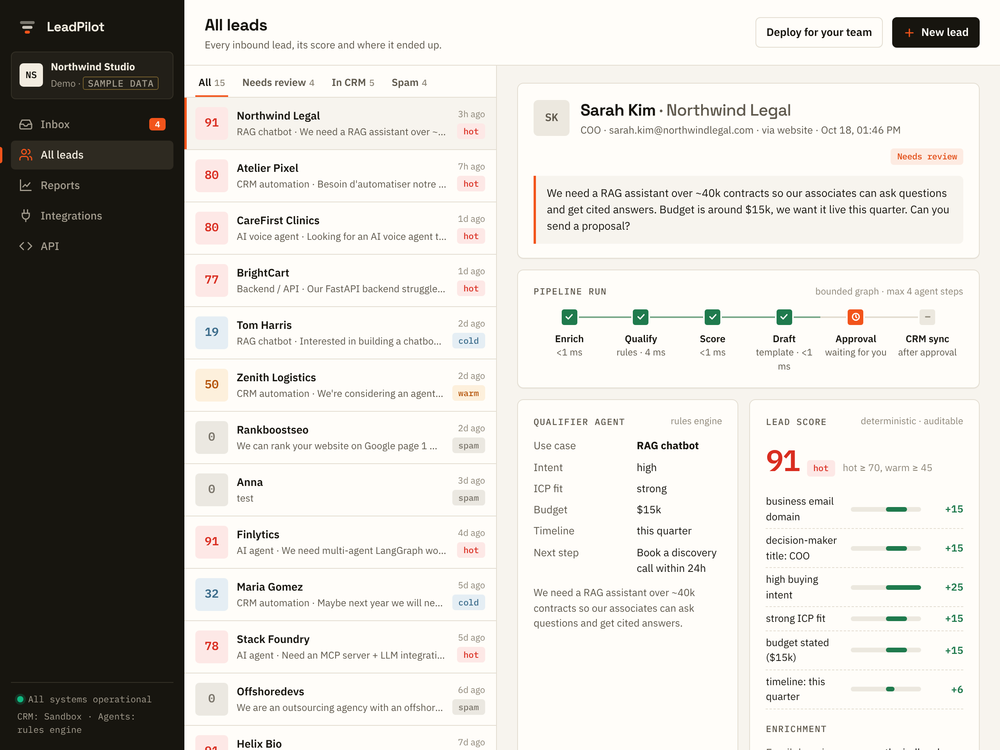
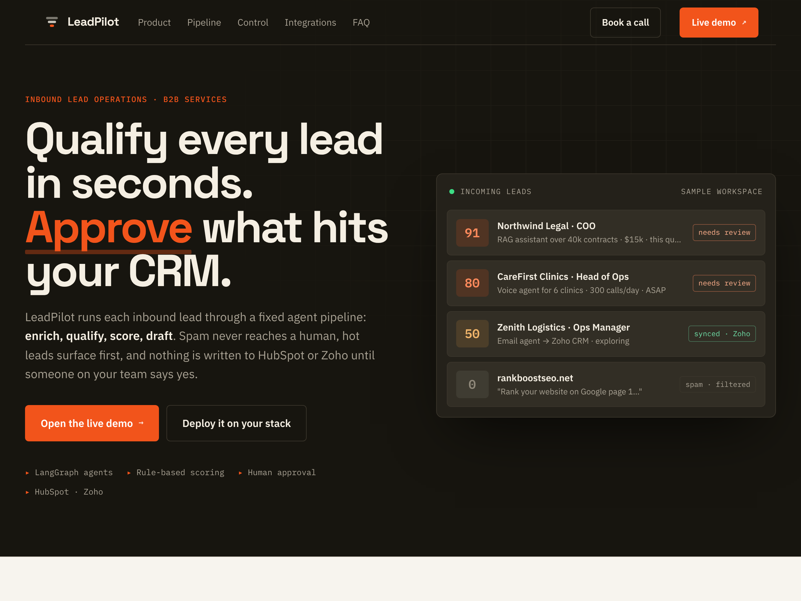
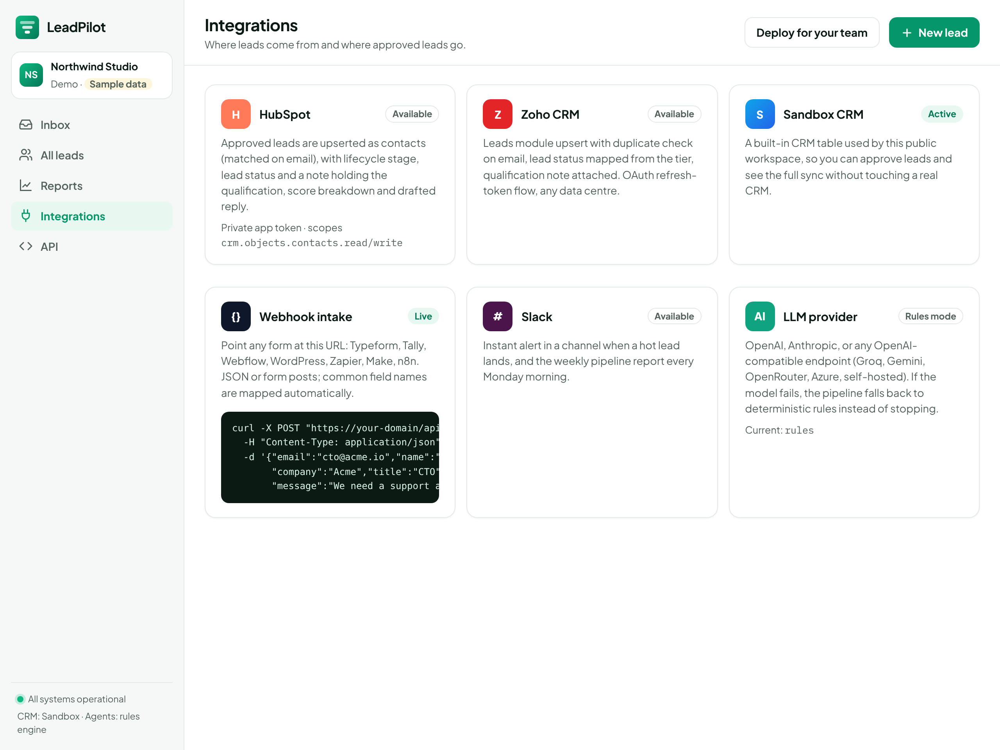

<p align="center"></p>

<h1 align="center">LeadPilot</h1>

<p align="center">
  <b>Qualify every inbound lead in seconds. Approve what goes into your CRM.</b><br>
  <a href="README.fr.md">Lire en français</a> ·
  <a href="https://leadpilot-rust-iota.vercel.app">Live demo</a> ·
  <a href="#run-it-locally">Run it locally</a>
</p>

<p align="center">
  
  
  
  
  
  
</p>



---

## Table of contents

1. [Overview](#overview)
2. [Design choices](#design-choices)
3. [How a lead is processed](#how-a-lead-is-processed)
4. [Features](#features)
5. [Scoring rules](#scoring-rules)
6. [Screenshots](#screenshots)
7. [Tech stack](#tech-stack)
8. [Project structure](#project-structure)
9. [Run it locally](#run-it-locally)
10. [Configuration](#configuration)
11. [API endpoints](#api-endpoints)
12. [Connect a real CRM](#connect-a-real-crm)
13. [Deployment](#deployment)
14. [Tests](#tests)

---

## Overview

B2B service teams receive leads from many places: website forms, Upwork, Malt, LinkedIn, Zapier or n8n automations. Someone has to read each one, decide if it is worth a reply, copy it into the CRM and write a first answer. Hot leads wait, spam gets in, and the CRM fills with half-filled records.

**LeadPilot** is a multi-agent system that does that triage for you:

1. it **enriches** each lead (email domain type, company website),
2. an AI agent **qualifies** it against your ideal customer profile (intent, fit, budget, timeline, use case),
3. a deterministic rule table **scores** it from 0 to 100, with a breakdown of every point,
4. **spam** and disposable emails are rejected automatically,
5. a second agent **drafts** the CRM note and a first reply email,
6. a human **approves** (and can edit) the draft before anything is written to **HubSpot** or **Zoho**,
7. every week an analyst agent writes a **pipeline report** around figures computed in SQL.

The app runs fully **without any API key**: with `LLM_PROVIDER=none` and `CRM_PROVIDER=mock`, deterministic heuristics replace the agents and a mock CRM stores the contacts. The public demo runs this way on a sample workspace (**Northwind Studio**) that resets every day.

## Design choices

| Problem in real sales teams | What LeadPilot does |
| --- | --- |
| Hot leads wait days because nobody triages the inbox | Every lead is processed in seconds; hot leads are posted to Slack |
| LLM scores drift and nobody can explain them | The LLM only **extracts signals**; the score comes from a deterministic rule table with a per-point breakdown |
| An AI writing straight into the CRM pollutes it | **Human in the loop**: nothing reaches the CRM until someone approves, and can edit, the draft |
| Agents that loop and burn tokens | A **bounded LangGraph graph**: at most 4 steps per lead, predictable cost |
| A provider outage stops the pipeline | Each agent has a deterministic fallback; a failed job is retried up to 3 times with an audit trail |
| Reports with invented numbers | Metrics are computed in SQL; the analyst agent only writes the text around them |
| Locked into one CRM | A `CRMAdapter` protocol: HubSpot and Zoho included, a new CRM is one file |

## How a lead is processed



**Lead statuses:** `received` → `processing` → `pending_approval` → `synced` (or `rejected` by a human). Spam goes straight to `auto_rejected`. A lead whose pipeline fails 3 times is marked `failed` and can be reprocessed.

**Where the pipeline runs:**
- on a long-running host (Docker, Render), the API answers immediately and a background worker processes the queue; a scheduler generates the weekly report;
- on Vercel (serverless), the bounded pipeline runs inside the request (a few seconds per lead), and a daily cron processes anything left in the queue and generates the report.

## Features

**Intake**
- `POST /api/leads` with an optional `Idempotency-Key` header: the same lead sent twice is stored once.
- `POST /api/webhooks/lead?source=...`: accepts JSON or form posts from Typeform, Webflow, Tally, WordPress, Zapier, n8n, and maps common field names automatically. Protected by a shared secret.

**Enrichment**
- Classifies the email domain: business, free (Gmail, Outlook...) or disposable.
- Reads the company website title and description.
- **SSRF guard:** private, loopback, link-local and reserved addresses are refused, and every redirect is checked hop by hop.

**Qualifier agent** (Pydantic structured output)
- Spam detection, buying intent, ICP fit, budget signal and amount, timeline, use case, need summary, recommended next step, and a reasoning that quotes the lead's own words.

**Writer agent**
- A CRM note for the sales team and a first reply email tailored to the lead, signed with your team name. The reply is a draft: LeadPilot stores it with the CRM note, it does not send emails.

**Human approval**
- Inbox with an approval queue, the pipeline run of each lead with step timings, the score breakdown, an editable draft (note, stage, reply), approve / reject / reprocess, and a full audit trail.

**CRM sync**
- **HubSpot:** searches the contact by email, creates or updates it (the lifecycle stage is set on creation, since HubSpot refuses to move it backwards), and adds an associated note.
- **Zoho CRM:** OAuth token refresh, upsert on email, adds a note.
- Retries on HTTP 429 and 5xx with exponential backoff, honouring `Retry-After`. If the CRM write fails, the lead stays in the approval queue.

**Weekly report**
- Lead volume and change versus the previous period, split by status, tier and source, top use cases, average score, spam filtered, approval rate, median time to review, hot leads still waiting, and 3 actions for next week. Posted to Slack if a webhook is configured.

**Web app and product site**
- `/app`: inbox, all leads, reports, integrations and API pages. Light and dark themes, mobile layout. Vanilla JavaScript, no build step.
- `/`: product landing page with a link to the live demo.

**Security**
- API key on private workspaces (`X-API-Key`), webhook shared secret, cron secret, SSRF guard, per-IP submission limit on the public demo.

## Scoring rules

The score is the sum of these rules, capped between 0 and 100 ([`app/scoring.py`](app/scoring.py)). Every rule that applies appears in the lead's breakdown with its reason.

| Rule | Points |
| --- | --- |
| Email domain | business +15 · free 0 · disposable −30 |
| Company website reachable | +5 |
| Job title | decision maker (founder, CEO, CTO, VP, director...) +15 · mid-level (manager, lead, PM...) +8 |
| Buying intent | high +25 · medium +12 · low 0 |
| ICP fit | strong +15 · partial +7 · none −10 |
| Budget | stated +15 · implied +8 · none 0 |
| Timeline | immediate +10 · this quarter +6 · later or unknown 0 |
| Message shorter than 20 characters | −10 |

Tiers: **hot** from 70, **warm** from 45, **cold** below (thresholds set by `HOT_THRESHOLD` and `WARM_THRESHOLD`). The tier sets the suggested CRM stage: hot → SQL, warm → MQL, cold → lead.

## Screenshots

| Weekly report | All leads |
| --- | --- |
|  |  |

| Landing page | Integrations |
| --- | --- |
|  |  |

## Tech stack

| Layer | Technology |
| --- | --- |
| Agents | LangGraph, LangChain (OpenAI, Anthropic, or any OpenAI-compatible endpoint such as Groq, Gemini, OpenRouter) |
| Backend | Python 3.12, FastAPI, Pydantic v2, APScheduler, httpx |
| Data | SQLAlchemy 2, PostgreSQL (SQLite for local development and tests) |
| Integrations | HubSpot CRM v3 API, Zoho CRM v6 API, Slack incoming webhooks |
| Front end | HTML, CSS, vanilla JavaScript (no build step) |
| Quality | pytest, GitHub Actions (SQLite and PostgreSQL runs, Docker build) |
| Deployment | Docker, Docker Compose, Render blueprint, Vercel + Neon |

## Project structure

```
app/
  main.py         FastAPI app, endpoints, worker thread, scheduler, cron
  graph.py        LangGraph pipeline: enrich → qualify → score → draft
  agents.py       Qualifier and writer agents and their deterministic fallbacks
  scoring.py      Deterministic rule table and tiers
  enrichment.py   Email domain and website enrichment, SSRF guard
  services.py     Job claim and processing, approval, rejection, Slack alert
  report.py       Weekly metrics and analyst agent
  llm.py          Model provider selection
  crm/            CRMAdapter protocol, HubSpot, Zoho, mock
  demo.py         Sample workspace for the public demo
  models.py       Lead, event and report tables
  schemas.py      API and agent output schemas
  static/         Product site and web app
docs/             French deployment guide, portfolio notes, screenshots
scripts/          Sends sample leads to a running instance
tests/            Pipeline, API, CRM and platform tests
```

## Run it locally

**With Docker** (API + PostgreSQL):

```bash
git clone https://github.com/Dioumadev221/leadpilot.git
cd leadpilot
cp .env.example .env            # add OPENAI_API_KEY, or set LLM_PROVIDER=none
docker compose up --build
# open http://localhost:8000/app (the app asks for API_KEY once)
```

**Without Docker** (SQLite, no key needed):

```bash
python -m venv .venv && source .venv/bin/activate
pip install -r requirements-dev.txt
SEED_DEMO=true LLM_PROVIDER=none uvicorn app.main:app --reload
```

**Send a lead:**

```bash
curl -X POST "localhost:8000/api/webhooks/lead?source=website" \
  -H "X-Webhook-Secret: $WEBHOOK_SECRET" -H "Content-Type: application/json" \
  -d '{"email":"cto@acme.io","name":"Alex Martin","company":"Acme","title":"CTO",
       "message":"We need a RAG assistant over our docs. Budget $12k, live next month."}'
```

Interactive API documentation: `http://localhost:8000/docs`.

## Configuration

All settings are environment variables (see [`.env.example`](.env.example)).

| Variable | Role |
| --- | --- |
| `DATABASE_URL` | PostgreSQL connection string (SQLite by default) |
| `API_KEY` | Sent as `X-API-Key` by the app and API clients. Empty = no auth (local or public demo only) |
| `WEBHOOK_SECRET` | `X-Webhook-Secret` header or `?secret=` on the webhook |
| `WORKSPACE_NAME`, `SENDER_NAME` | Your company name and the signature of drafted replies |
| `ICP_DESCRIPTION` | Your ideal customer profile, used by the qualifier agent |
| `LLM_PROVIDER` | `openai`, `anthropic` or `none` (deterministic heuristics, no key) |
| `LLM_MODEL`, `OPENAI_API_KEY`, `OPENAI_BASE_URL`, `ANTHROPIC_API_KEY` | Model settings. `OPENAI_BASE_URL` accepts any OpenAI-compatible endpoint |
| `CRM_PROVIDER` | `mock`, `hubspot` or `zoho` |
| `HUBSPOT_TOKEN` | HubSpot private app token |
| `ZOHO_CLIENT_ID`, `ZOHO_CLIENT_SECRET`, `ZOHO_REFRESH_TOKEN`, `ZOHO_DC` | Zoho OAuth and data center (`com`, `eu`, `in`...) |
| `HOT_THRESHOLD`, `WARM_THRESHOLD` | Tier thresholds (70 and 45 by default) |
| `SLACK_WEBHOOK_URL` | Hot lead alerts and weekly report |
| `RUN_WORKER`, `REPORT_CRON_DAY`, `REPORT_CRON_HOUR` | Background worker and weekly report schedule (long-running hosts) |
| `ENRICH_FETCH_WEBSITE` | Turns website enrichment on or off |
| `DEMO_MODE`, `DEMO_SUBMISSIONS_PER_HOUR`, `SEED_DEMO`, `CRON_SECRET`, `PUBLIC_URL`, `CONTACT_URL` | Public demo, sample data, cron protection, link previews |

## API endpoints

| Method | Path | Description |
| --- | --- | --- |
| `POST` | `/api/leads` | Create a lead (`Idempotency-Key` supported) |
| `POST` | `/api/webhooks/lead` | Receive a lead from a form or automation tool |
| `GET` | `/api/leads` | List leads |
| `GET` | `/api/leads/{id}` | Lead detail with enrichment, qualification, score breakdown, draft and events |
| `POST` | `/api/leads/{id}/approve` | Approve (with optional edits) and write to the CRM |
| `POST` | `/api/leads/{id}/reject` | Reject with a reason |
| `POST` | `/api/leads/{id}/reprocess` | Run the pipeline again |
| `GET` | `/api/stats` | Counters for the app |
| `GET` | `/api/reports`, `/api/reports/latest` | Weekly reports |
| `POST` | `/api/reports/generate` | Generate a report now |
| `GET` | `/api/meta` | Workspace, LLM and CRM mode for the app |
| `GET` | `/api/cron/daily` | Daily cron: drain the queue, report, demo reset |
| `GET` | `/health` | Health check |

## Connect a real CRM

**HubSpot (free plan works):** Settings → Integrations → Private Apps → create an app with the scopes `crm.objects.contacts.read` and `crm.objects.contacts.write` → copy the token → set `CRM_PROVIDER=hubspot` and `HUBSPOT_TOKEN=pat-...`.

**Zoho CRM:** api-console.zoho.com → Self Client → scopes `ZohoCRM.modules.leads.ALL,ZohoCRM.modules.notes.CREATE` → generate a code → exchange it once for a refresh token:

```bash
curl -X POST "https://accounts.zoho.com/oauth/v2/token?grant_type=authorization_code&client_id=ID&client_secret=SECRET&code=CODE"
```

Then set `CRM_PROVIDER=zoho`, `ZOHO_CLIENT_ID`, `ZOHO_CLIENT_SECRET`, `ZOHO_REFRESH_TOKEN` and `ZOHO_DC`.

## Deployment

### Vercel + Neon (serverless, free tier)

[](https://vercel.com/new/clone?repository-url=https%3A%2F%2Fgithub.com%2FDioumadev221%2Fleadpilot)

1. Create a Postgres database on [Neon](https://neon.tech) and copy the **pooled** connection string.
2. Import the repository in Vercel. [`vercel.json`](vercel.json) sets the function timeout and a daily cron on `/api/cron/daily`.
3. Set the environment variables: `DATABASE_URL`, `CRON_SECRET`, `API_KEY`, `WEBHOOK_SECRET`, plus your model and CRM keys. For a public demo, set `DEMO_MODE=true` and leave `API_KEY` empty.
4. Deploy, then set `PUBLIC_URL` to the final domain so link previews show the product image.

A step-by-step guide in French is in [`docs/DEPLOY_FR.md`](docs/DEPLOY_FR.md).

### Docker / Render

`docker compose up`, or Render → New → **Blueprint**: [`render.yaml`](render.yaml) creates the web service and the PostgreSQL database. On a long-running host the background worker and the weekly scheduler are on, so a single instance is enough.

## Tests

```bash
pip install -r requirements-dev.txt
pytest -q
```

The suite covers pipeline routing (hot, cold, spam, disposable email), deterministic scoring, fallback when the model fails, the full API flow up to the CRM, idempotency, webhook field mapping, retries until `failed`, report metrics, authentication, the cron secret and demo reset, the demo rate limit, serverless inline processing, the SSRF guard, and the HubSpot and Zoho request shapes against mocked HTTP.

GitHub Actions runs the tests on SQLite and on PostgreSQL, then builds the Docker image, on every push and pull request.
