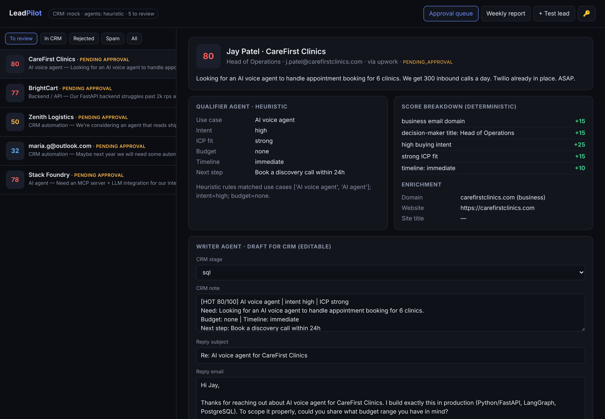
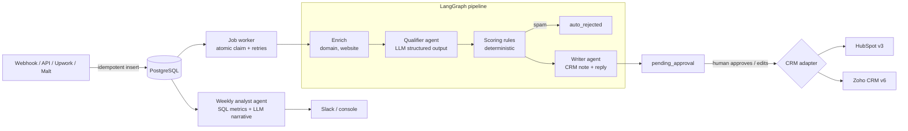

# LeadPilot — multi-agent lead qualification & CRM automation

Inbound leads arrive from forms, Upwork, Malt, LinkedIn or any webhook. LeadPilot **enriches** them, has an LLM agent **qualify** them against your ideal customer profile, **scores** them with an auditable rule table, **filters spam**, drafts the **CRM note and first reply**, and waits for a **human to approve** before anything is written to **HubSpot or Zoho**. Every Monday an analyst agent writes the **weekly pipeline report**.



## Why it is built this way

| Problem in real sales teams | What LeadPilot does |
|---|---|
| Hot leads wait days because nobody triages the inbox | Every lead is qualified in seconds; hot ones ping Slack |
| LLM scores drift and nobody can explain them | The LLM only **extracts signals**; the score is a deterministic rule table with a per-point breakdown |
| An AI writing straight into the CRM pollutes it | **Human-in-the-loop**: nothing reaches the CRM until someone approves (and can edit) the draft |
| Agents that loop and burn tokens | A **bounded LangGraph DAG**: max 4 steps per lead, predictable cost |
| Provider outage = pipeline down | Each agent has a deterministic fallback; failures retry 3x with an audit trail |
| Reports with invented numbers | Metrics come from SQL; the analyst agent only writes the narrative around them |
| Locked into one CRM | `CRMAdapter` protocol: HubSpot and Zoho included, new CRM = one file |

## Architecture



**Stack:** Python 3.12, FastAPI, LangGraph, LangChain (OpenAI or Anthropic), SQLAlchemy 2 + PostgreSQL, APScheduler, httpx, Docker, GitHub Actions.

## Features

- **Intake:** `POST /api/leads` (with `Idempotency-Key`) and `POST /api/webhooks/lead` that maps fields from Typeform, Webflow, Tally, WordPress, Zapier, n8n (JSON or form posts, shared secret).
- **Enrichment:** business vs free vs disposable email, company website title/description.
- **Qualifier agent:** intent, ICP fit, budget, timeline, use case, next step, reasoning quoting the lead (Pydantic structured output).
- **Scoring:** 9 rules, 0–100, hot / warm / cold, thresholds via env.
- **Writer agent:** CRM note + first reply email tailored to the lead.
- **Approval console** (`/`): queue, score breakdown, editable draft, approve/reject, audit trail, report view.
- **CRM sync:** HubSpot (search → create/patch contact, note associated to contact, lifecycle stage), Zoho (OAuth refresh, upsert on Email, note). Retries on 429/5xx with `Retry-After`.
- **Jobs:** DB-backed queue with atomic `received → processing` claim, 3 attempts then `failed`; weekly report on cron.
- **Report:** volume and week-over-week change, tiers, sources, top use cases, approval rate, median review time, hot leads waiting, 3 actions.
- **Runs without any key:** `LLM_PROVIDER=none` and `CRM_PROVIDER=mock` give a full working demo.

## Run it locally

```bash
cp .env.example .env            # put your OPENAI_API_KEY, or set LLM_PROVIDER=none
docker compose up --build       # API + PostgreSQL
open http://localhost:8000      # console; enter API_KEY via the key button
```

Without Docker:

```bash
python -m venv .venv && source .venv/bin/activate
pip install -r requirements-dev.txt
SEED_DEMO=true LLM_PROVIDER=none uvicorn app.main:app --reload
pytest -q
```

Send a lead:

```bash
curl -X POST localhost:8000/api/webhooks/lead?source=website \
  -H "X-Webhook-Secret: $WEBHOOK_SECRET" -H "Content-Type: application/json" \
  -d '{"email":"cto@acme.io","name":"Alex Martin","company":"Acme","title":"CTO",
       "message":"We need a RAG assistant over our docs. Budget $12k, live next month."}'
```

API docs: `http://localhost:8000/docs`.

## Connect a real CRM

**HubSpot (free):** Settings → Integrations → Private Apps → create app with scopes `crm.objects.contacts.read` and `crm.objects.contacts.write` → copy the token → `CRM_PROVIDER=hubspot`, `HUBSPOT_TOKEN=pat-...`.

**Zoho CRM:** api-console.zoho.com → Self Client → scopes `ZohoCRM.modules.leads.ALL,ZohoCRM.modules.notes.CREATE` → generate code → exchange it once for a refresh token:

```bash
curl -X POST "https://accounts.zoho.com/oauth/v2/token?grant_type=authorization_code&client_id=ID&client_secret=SECRET&code=CODE"
```

Then `CRM_PROVIDER=zoho`, `ZOHO_CLIENT_ID`, `ZOHO_CLIENT_SECRET`, `ZOHO_REFRESH_TOKEN`, `ZOHO_DC` (`com`, `eu`, `in`...).

## Deploy (Render, free)

1. Push this repo to GitHub.
2. Render → New → **Blueprint** → select the repo. `render.yaml` creates the Docker web service and a PostgreSQL database, and generates `API_KEY` and `WEBHOOK_SECRET`.
3. Add `OPENAI_API_KEY` and set `LLM_PROVIDER=openai` in the service environment.
4. Open the URL, click the key button, paste `API_KEY` (visible in the Render env tab).

Free tier notes: the web service sleeps after 15 min idle (first request wakes it); Render free Postgres expires after 30 days, so for a long-lived demo point `DATABASE_URL` at a free Neon or Supabase database instead. Run a single instance: the worker and scheduler live in-process.

## Tests

18 tests: pipeline routing (hot / cold / spam / disposable), deterministic scoring, LLM failure fallback, full API flow to CRM, idempotency, webhook field mapping, retries → failed, report metrics, auth, and HubSpot/Zoho request shapes against mocked HTTP. CI runs them on SQLite **and** PostgreSQL, then builds the image.

## Project layout

```
app/
  main.py         FastAPI app, worker thread, scheduler, endpoints
  graph.py        LangGraph pipeline
  agents.py       qualifier + writer agents and their fallbacks
  scoring.py      deterministic rule table
  enrichment.py   domain + website enrichment
  services.py     job claim/processing, approval, rejection
  report.py       weekly metrics + analyst agent
  crm/            CRMAdapter protocol, HubSpot, Zoho, mock
  static/         approval console (vanilla JS, no build step)
tests/
```
